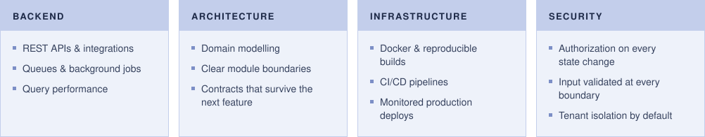

## About

> **I build and maintain complete software systems** — backend, APIs, infrastructure and delivery —
> with correctness, maintainability and security as the baseline, not the goal.

Most of my work is **multi-tenant SaaS**: products where data isolation, authorization and predictable performance are requirements from day one. I take them from the first data model to production, and keep them running there.

## Stack

<table>
<tr>
<td><b>Languages</b></td>
<td>

</td>
</tr>
<tr>
<td><b>Backend</b></td>
<td>

</td>
</tr>
<tr>
<td><b>Frontend</b></td>
<td>

</td>
</tr>
<tr>
<td><b>Infra & DevOps</b></td>
<td>

</td>
</tr>
<tr>
<td><b>Databases</b></td>
<td>

</td>
</tr>
</table>
